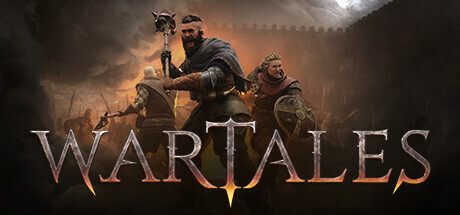

**Wartales by Shiro Games (2023) is a medieval open-world tactical RPG where you lead a mercenary company for profit and survival.**

---

## 📖 About

Wartales by Shiro Games (2023) is a medieval open-world tactical RPG where you lead a mercenary company for profit and survival. With no main quest, the world reacts dynamically to your choices — alliances, crimes, and deaths all matter. The economic loop demands constant attention to troop upkeep.

## ⚠️ Problems Without Trainer

| Problem | Status |
|---------|--------|
| Troop wages deplete treasury faster than contracts can replenish income | ✅ Solved |
| Suspicion system triggers town guards after single unlawful act anywhere | ✅ Solved |
| High-tier enemy ambushes outscale the party without specific build preparation | ✅ Solved |
| Knowledge unlock requirements demand specific exploration paths easy to miss | ✅ Solved |
| Companion loyalty drops from battle injuries causing morale cascade events | ✅ Solved |

## ✅ Solution

The **Wartales Trainer** solves all these issues, giving you complete control so you can focus on enjoying the game.

## 🎯 Features

- Unlimited Resources / Currency
- God Mode / Invincibility
- Instant Skill & Ability Cooldown
- One-Hit Kill
- Freeze Timers
- Unlock All Items & Achievements
- Custom Speed Multiplier
- Infinite Stamina / Energy

## 🚀 Quick Start

1. **Disable Windows Defender** temporarily (trainer may trigger false positive)
2. Get the trainer from the button above
3. Launch Wartales
4. Run the trainer as Administrator
5. Use the hotkeys to activate cheats in-game

## 💎 Free vs Pro

| Feature | Free | Pro |
|---------|------|-----|
| God Mode | ✅ | ✅ |
| Unlimited Resources | ✅ | ✅ |
| Advanced Cheats | ❌ | ✅ |
| Auto-Updates | ❌ | ✅ |
| Priority Support | ❌ | ✅ |

## 💻 Requirements

- Windows 10 / 11 (64-bit)
- Wartales (any version)
- .NET Framework 4.8+
- DirectX 11+

## 🍎 macOS

## ⚖️ Legal

Educational and single-player use only.

---

